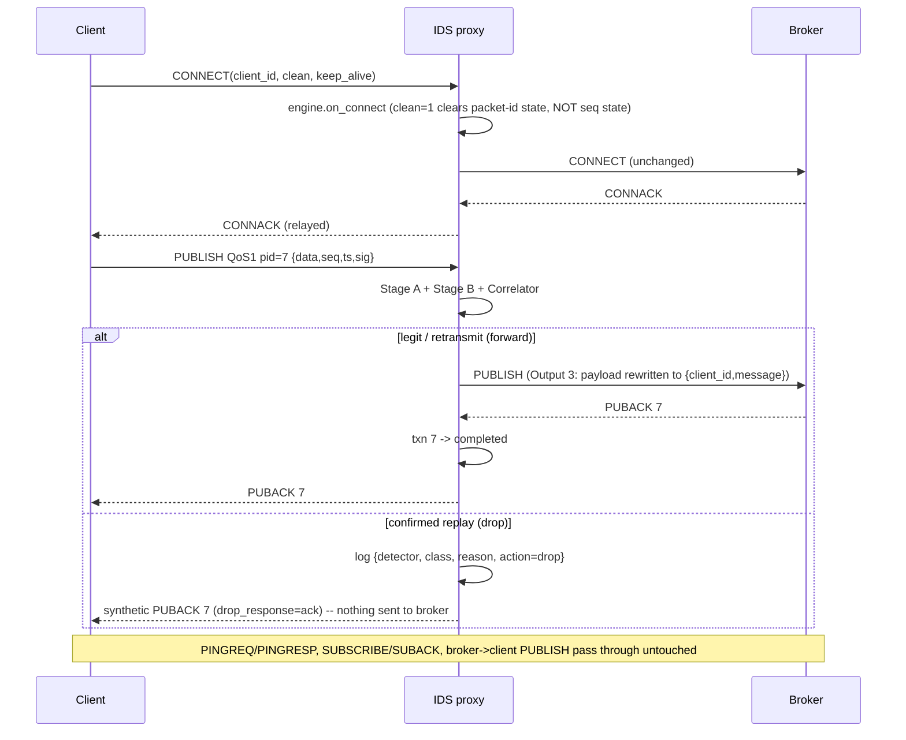
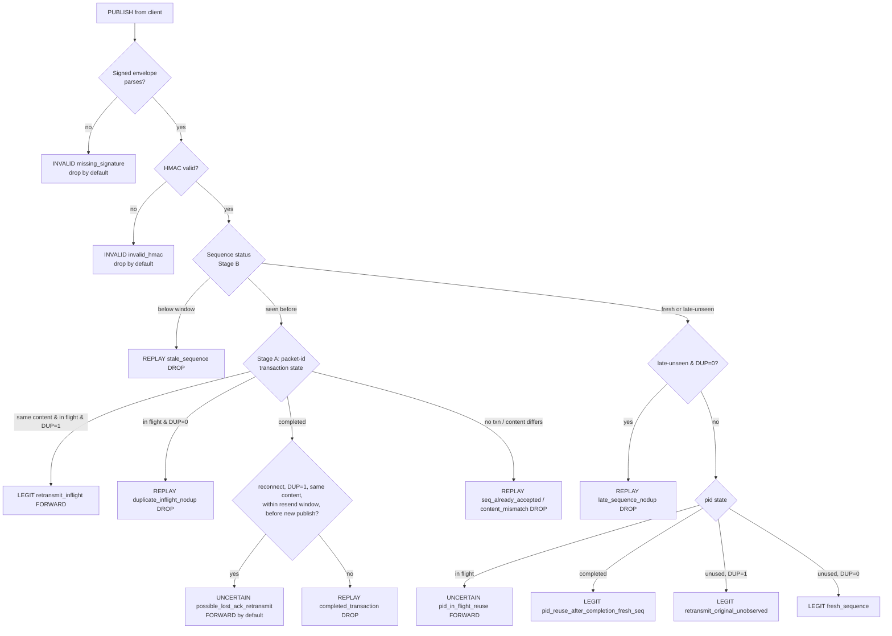

# Architecture and packet flow

## 1. Deployment (the three outputs)

```
Output 1  NO IDS
  [client] ───────────────────────────────────────────────▶ [broker]
   (signed payloads sent, nothing is checked)

Output 2  LAYERED IDS
  [client] ──▶ [ IDS proxy :1884 ] ──forward legit──────▶ [broker :1883]
                │  Stage A  packet-id / DUP / ack state
                │  Stage B  HMAC + sequence freshness      ◀── PUBACK/PUBREC/PUBCOMP,
                │  Correlator ──▶ forward | drop               SUBACK, PUBLISH relayed back
                └─ decisions.jsonl (detector, class, reason, action)

Output 3  LAYERED IDS + MINIMIZED APPLICATION DATA
  same as Output 2, but the forwarded PUBLISH payload becomes
        {"client_id": "...", "message": <device data>}      (no sig / seq / ts)
  and  app_feed.jsonl  carries {client_id, message, keep_alive}
  [consumer_min] ◀── broker ◀── minimized PUBLISH
```

## 2. Packet flow through the proxy (Output 2 / 3)



## 3. Decision pipeline



## 4. Why both layers are needed (measured on the real capture, see README)

| Failure of one layer | Example | Fixed by |
|---|---|---|
| Packet-ID rule misses DUP-evasion replay (recall 0.50) | replay with DUP=1 on an ACKed id | seen-sequence check (Stage B) |
| Packet-ID rule flags legitimate id reuse after ACK | id 7 reused with a *new* signed seq | fresh seq overrides (Stage B) |
| HMAC freshness flags legitimate retransmissions (770 FPs) | DUP=1 resend, original seq | open-transaction state + seen-set (Stage A) |
| HMAC alone accepts a bit-exact replay | valid signature, old message | seq state; HMAC is only authenticity |
| Clean-session reconnect erases packet-id state | replay after reconnect | seq state survives reconnects |

## 5. Code map

| File | Role |
|---|---|
| `external_eval/*` | ORIGINAL code, dataset, results (unmodified; reused: `mqtt_io`, `signing`, `score`, `detectors` as baselines) |
| `replay_ids/engine.py` | Stage A, Stage B, correlator (shared by Outputs 2 and 3) |
| `replay_ids/proxy.py` | asyncio TCP proxy, drop/forward/ack-synthesis, minimization hook |
| `replay_ids/codec.py` | stream framer, CONNECT/PUBLISH/ack parse + build |
| `replay_ids/minimizer.py` | Output 3 payload + app feed |
| `replay_ids/consumer_min.py` | Output 3 demo consumer |
| `replay_ids/mini_broker.py` | zero-install test broker (logs every PUBLISH it receives) |
| `eval/offline_eval.py`, `eval/live_eval.py` | scoring on the existing dataset (offline / over real TCP) |
| `run_output{1,2,3}_*.py`, `run_all.py` | the three entry points + everything-at-once |
